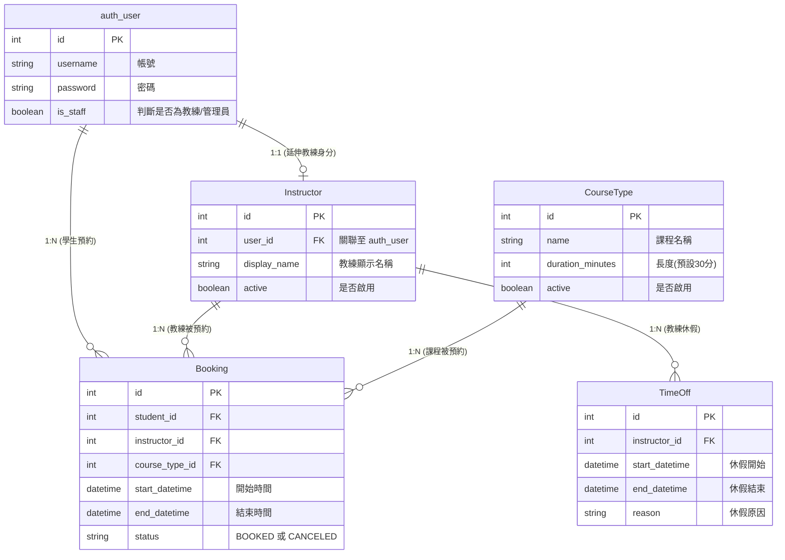

# Vibe Booking 後端系統

這是 Vibe Booking System 的後端專案。本專案提供基於 Django、Django REST Framework、PostgreSQL 以及 JWT (JSON Web Tokens) 的 RESTful API 服務。

## 技術堆疊

- **Python 3.10.18**
- **Django 4.2+**
- **Django REST Framework (DRF)**
- **PostgreSQL 16 (透過 Docker 執行)**
- **JSON Web Tokens (JWT)** 使用 `djangorestframework-simplejwt` 套件
- **OpenAPI 規格生成** 使用 `drf-spectacular` 套件
- **System Localization:** 預設語言為繁體中文 (`zh-hant`)，時區為 `Asia/Taipei` (UTC+8)
- **python-dotenv**
- **django-cors-headers**

---

## 快速開始 (Docker 快速啟動)

本專案已全面 Docker 化，並包含了自動化的啟動腳本 (`entrypoint.sh`)。
您**不需要**在本地電腦安裝 PostgreSQL 或手動執行資料庫遷移，只要您的電腦有安裝 Docker Desktop 即可一鍵啟動。

### 1. 系統需求
- Docker 與 Docker Compose (請確保 Docker Desktop 已開啟並常駐執行)

### 2. 環境變數設定
在專案內的 `backend/` 目錄底下，建立一個 `.env` 檔案，並貼上以下預設開發設定：

```env
DJANGO_SECRET_KEY=django-insecure-example-secret-key-12345
DJANGO_DEBUG=1
DJANGO_ALLOWED_HOSTS=*
DB_HOST=postgres
DB_PORT=5432
DB_NAME=vibe_booking
DB_USER=vibe
DB_PASSWORD=vibe123
TIME_ZONE=Asia/Taipei
```

### 3. 一鍵啟動所有服務

在專案最外層目錄 (與 `docker-compose.yml` 同層)，執行以下指令：

```bash
docker compose up --build
```

這行指令會全自動幫您完成以下動作：
1. 下載並啟動 PostgreSQL 16 資料庫
2. 安裝 Python 依賴套件並啟動 Django 容器
3. 自動執行資料庫遷移 (`python manage.py migrate`)
4. 啟動 Django 開發伺服器 (Port: 8000)

啟動完成後，您會看到 `Watching for file changes with StatReloader`，此時伺服器已準備就緒！
您可以透過 `http://localhost:8000/api/docs/` 存取 Swagger API 文件，或是 `http://localhost:8000/admin/` 進入超級管理員後台。

---

## 選用的本機測試資料

若需要以下示範帳號，在本機開發資料庫啟動後執行一次：

```bash
docker compose exec -T web python manage.py dbshell < seed.sql
```

正式環境請用 `python manage.py createsuperuser` 建立自己的管理員。

自動匯入的 `seed.sql` 已經為您準備好了三組用於測試的帳號，**所有帳號的密碼皆統一為：`vibe123`**

| 身分 | 帳號 (Username) | 權限範圍 |
|---|---|---|
| **超級管理員** | `admin` | 可登入 Django `/admin/` 後台，擁有最高權限 |
| **教練** | `instructor01` | 具有 `is_staff` 權限的教練帳號 |
| **學生** | `student01` | 一般客戶/學生的測試帳號 |

---

## API 說明文件 (OpenAPI)

專案已經整合 `drf-spectacular` 以自動生成互動式的 OpenAPI 文件。在開發伺服器啟動後，您可以透過瀏覽器存取以下連結：

- **Swagger UI 介面:** `http://127.0.0.1:8000/api/docs/`
- **ReDoc 介面:** `http://127.0.0.1:8000/api/redoc/`
- **Schema 規格 (YAML 配置):** `http://127.0.0.1:8000/api/schema/`

---

## 資料庫關聯圖 (Schema)

下圖展示了系統中五個核心資料表的關聯設計 (Entity-Relationship Diagram)：



---

## 核心功能與商業規則

### 預約時間與限制
- **營業時間:** 08:00–22:00。
- **預約長度:** 目前版本僅允許每筆預約時間為 **30 分鐘**。
- **時段限制:** 預約的開始時間只能在**整點 (00)** 或是 **半點 (30)**，例如：`08:00`, `08:30`。因為最後預約時長必須在 22:00 結束，因此最晚的有效預約開始時間為 `21:30`。
- **時區:** 所有 datetime 相關的時間欄位皆為 `Asia/Taipei` (UTC+8)。

### 統一錯誤回應格式
API 的錯誤訊息一律採用以下標準化的 JSON 格式回傳，方便前端捕捉狀態：
```json
{
  "error": {
    "code": "VALIDATION_ERROR",
    "message": "Validation failed",
    "details": {}
  }
}
```
**常見錯誤代碼 (Error Codes)**: `FORBIDDEN` (禁止存取), `NOT_FOUND` (找不到資源), `SLOT_TAKEN` (該時段已被預約), `INVALID_QUERY` (無效的查詢), `VALIDATION_ERROR` (欄位驗證錯誤), `UNAUTHORIZED` (未授權)。

### 核心 API 端點服務一覽

| 資源 (Resource) | 請求方法 (Methods) | 端點 (Endpoint) | 功能說明 (Description) |
|---|---|---|---|
| JWT Token 取得 | POST | `/api/auth/token/` | 登入並取得 access 及 refresh token。 |
| Token 重新刷新 | POST | `/api/auth/token/refresh/` | 使用 refresh token 換取新的 access token。 |
| 使用者註冊 | POST | `/api/users/register/` | 建立新使用者帳號（不需驗證）。 |
| 當前使用者 | GET | `/api/users/me/` | 取得已登入使用者的個人資料。 |
| 課程類型清單 | GET | `/api/course-types/` | 列出所有可用的課程類型清單。 |
| 課程類型詳情 | GET | `/api/course-types/{id}/` | 取得單一課程類型的詳細資料。 |
| 教練清單 | GET | `/api/instructors/` | 列出目前開放預約的教練清單。 |
| 教練詳情 | GET | `/api/instructors/{id}/` | 取得單一教練的詳細資料。 |
| 查詢可預約時段 | GET | `/api/slots/?instructor_id=X&date=YYYY-MM-DD` | 輸入日期與教練，列出每個可用及不可用 (衝突) 的單一時段。 |
| 管理預約 (清單/創建) | GET, POST | `/api/bookings/` | 取得個人的預約清單，或建立一筆新的預約資料。 |
| 取消預約 | DELETE | `/api/bookings/{id}/` | 將單筆預約標記為「已取消 (Soft-cancel)」。 |
